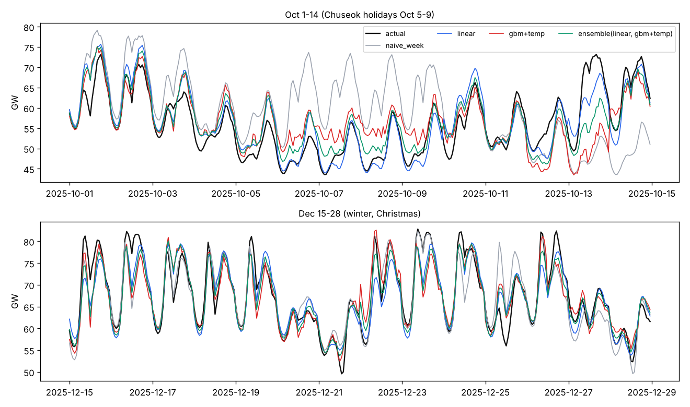

# power-demand — 하루 전 전국 시간별 전력 수요 예측 (2025)

한국전력거래소가 공개한 **2025년 시간별 전국 전력수요량**(8,760시간, MW)으로, 전날 24시간 수요를 한꺼번에 예측하는 모델을 만들고 기준선과 비교했습니다. 에너지 공기업에서 쓰는 '하루 전 수요 예측'의 기본 틀을 공개 데이터로 재현해 본 프로젝트입니다.

- 수요: 공공데이터포털 [한국전력거래소_시간별 전국 전력수요량](https://www.data.go.kr/data/15065266/fileData.do) (2025.01.01~12.31). 원본 CP949 → UTF-8 로만 바꿔 `data/` 에 포함
- 기온: [Open-Meteo Historical Weather API](https://open-meteo.com/) (ERA5 재분석, CC BY 4.0) — 서울·부산·대전·광주 시간별 기온 평균
- 2025년 최대 수요: **95,951 MW (8월 25일 17시)**

## 문제 설정

- **예측 시점**: D-1일에 D일 0~23시를 한 번에 예측 → 수요는 24시간 이상 지난 값만 사용 (어제·지난주 같은 시각, 어제 평균)
- **특징**: 시각 × 날 종류(평일/토/일·공휴일), 월, 지연값, 기온(냉방·난방 구간을 나눈 형태)
- **기온 가정**: 실제 관측 기온을 '완벽한 예보'로 넣었으므로 운영 성능은 이보다 나쁩니다. 그래서 기온 없는 모델도 함께 비교합니다.
- **분할**: 1~9월 학습 / **10~12월 시험** (추석 연휴 10/5~10/9 포함, 시험 기간은 학습에 쓰지 않음)

## 결과 (`reports/results.json`, MAPE %)

| 모델 | 전체 | 일 최대수요 | 공휴일 | 그 외 |
|---|---|---|---|---|
| 지난주 같은 시각 (기준선) | 6.17 | 5.51 | 20.70 | 4.98 |
| 선형 (기온 없음) | 3.74 | 3.19 | **3.99** | 3.72 |
| 선형 + 기온 | 4.77 | 3.07 | 5.20 | 4.73 |
| GBM (기온 없음) | 4.17 | 3.10 | 8.34 | 3.83 |
| GBM + 기온 | 3.86 | 2.94 | 8.54 | 3.47 |
| **선형 + GBM(+기온) 평균** | **3.23** | **2.64** | 5.38 | **3.05** |



## 읽은 것

- **공휴일은 트리 모델의 약점**: 1~9월 학습 데이터에 공휴일 시간이 적어 GBM 은 공휴일 오차가 평일의 두 배 이상입니다. '시각 × 날 종류' 구조를 그대로 쓰는 선형 모델은 공휴일에서 오히려 안정적이었습니다.
- **기온의 효과는 모델에 따라 반대**: GBM 은 기온을 넣자 평일 오차가 줄었지만, 선형 모델은 나빠졌습니다. 월 더미와 기온이 겹치고, 기온-수요 관계가 비선형(냉방·난방 구간)이라 선형 항 몇 개로는 부족했던 것으로 봅니다.
- **두 모델의 평균**이 가장 좋았습니다(전체 3.23%, 일 최대수요 2.64%). 서로 다른 구간에서 틀리는 모델을 섞은 효과입니다.
- **긴 연휴 직후 첫 평일**(10/13)은 모든 모델이 크게 낮게 예측합니다. '어제 값'이 연휴 수요라서입니다. 연휴 다음 날 표시나 '마지막 평일 값'을 특징으로 넣는 것이 다음 개선 과제입니다.
- **한계**: 1년치만 공개돼 있어 같은 계절을 두 번 학습하지 못했습니다(10~12월 시험에 대해 직전 가을 데이터가 없음). 여러 해 자료와 실제 기온 예보를 쓰면 결과가 달라질 수 있습니다.

## 실행

```bash
pip install numpy scikit-learn matplotlib pytest
python -m powerfc.run     # 기온 파일이 없으면 Open-Meteo 에서 한 번 받음
python -m pytest -q       # 테스트 4개 (지연값 누수 검사 포함)
```
