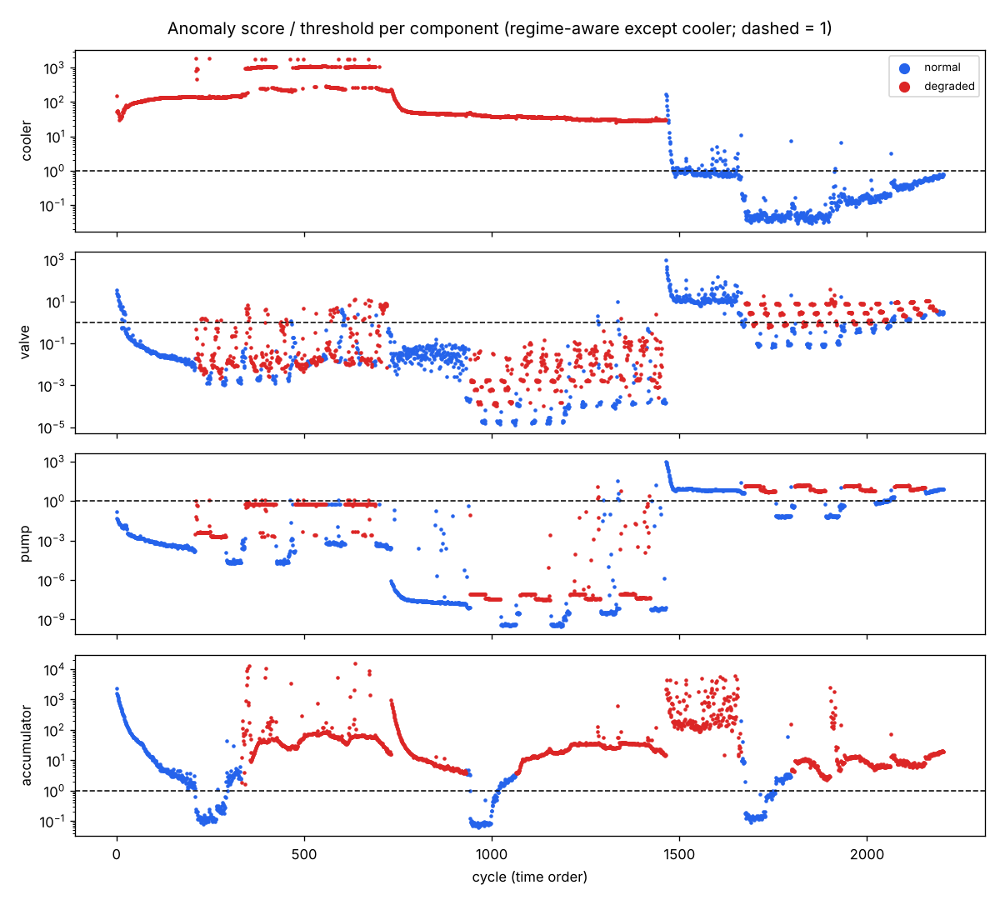

# sensor-anomaly — 유압 설비 센서로 부품 열화 찾기

공개 설비 데이터(UCI *Condition monitoring of hydraulic systems*, ZeMA, CC BY 4.0)로 **부품별 이상 탐지 → 스트리밍 경보 → 지도학습 진단**을 실험하고, 특히 *평가를 어떻게 나누느냐에 따라 결론이 얼마나 달라지는지*를 정리한 프로젝트입니다.

- 데이터: 유압 시험 설비 2,205 사이클(사이클당 60초) × 센서 17개(압력 6·모터 전력·유량 2·온도 4·진동·가상 센서 3, 1~100 Hz). 냉각기·밸브·펌프·축압기 네 부품의 상태를 단계별로 바꿔 가며 측정했고, **네 고장이 동시에 겹쳐 있습니다.**
- 특징: 센서마다 사이클 단위 통계 8개(평균·표준편차·최소·최대·5/95 백분위·기울기·차분 RMS) → 136개
- 재현: `python -m sensoranom.run` (원본 ZIP 을 내려받아 SHA-256 확인 → 특징 캐시 → `reports/results.json`, `reports/scores.png`)

## 결과 (`reports/results.json`)

### 1) 지도학습 진단 — 분할 방식이 결론을 바꿈

| 부품 | RandomForest · 무작위 분할 | RandomForest · **시간 구간 분할** | LDA · 무작위 | LDA · **시간 구간** |
|---|---|---|---|---|
| 냉각기 | 0.999 | 1.000 | 1.000 | 1.000 |
| 밸브 | 0.992 | **0.456** | 1.000 | **1.000** |
| 펌프 | 0.999 | **0.752** | 0.999 | **1.000** |
| 축압기 | 0.997 | **0.397** | 0.949 | **0.553** |

(정확도. 시간 구간 분할 = 사이클을 10구간으로 나눠 마지막 3구간을 시험용)

- 이웃한 사이클은 거의 같은 값이라 **무작위 분할은 시험 데이터의 '쌍둥이'가 학습에 들어가 성능이 부풀려집니다** (모든 부품 0.99 이상).
- 과거로 학습해 미래를 맞히는 시간 구간 분할에서는 RandomForest 가 크게 떨어지고, 표준화 + LDA(선형) 는 냉각기·밸브·펌프에서 1.00 을 유지했습니다. 시험 구간이 학습 때와 다른 냉각기 상태(운전 조건)에 있어, 학습 범위 밖 값에 약한 트리 모델이 먼저 무너진 것으로 봅니다.
- 축압기는 어느 조합에서도 어렵습니다(0.55). 모델 선택보다 축압기 압력 변화를 잡는 특징(예: 압력 상승 구간의 시정수)이 더 필요하다는 신호로 보고 다음 과제로 남깁니다.

### 2) 부품별 비지도 이상 탐지 — 겹친 고장에서는 한계

부품마다 '그 부품이 최적 상태인 사이클'의 시간 순 앞 60% 로 정상 모델(표준화 + Ledoit-Wolf 공분산 마할라노비스 거리)을 만들고, 학습에 쓰지 않은 정상 사이클의 99번째 백분위를 임계값으로 썼습니다.

| 부품 | ROC-AUC | 시험 정상 오경보 | 고장 탐지율 |
|---|---|---|---|
| 냉각기 | **0.993** | 16.7% | 100% |
| 밸브 | 0.53 (운전구간별 모델 0.44) | 48% | 43% |
| 펌프 | 0.64 (0.62) | 54% | 99% |
| 축압기 | 0.55 (0.79) | 79% | 90% |

- 냉각기처럼 큰 변화는 비지도로도 잡히지만, 나머지 부품은 **다른 부품의 상태 변화가 '이상'으로 보여** 오경보가 많습니다. 냉각기 상태별로 정상 모델을 따로 만드는 운전 구간 모델도 시도했지만 밸브·펌프에서는 개선되지 않았습니다.
- `reports/scores.png` 에서 각 냉각기 구간 시작마다 점수가 높았다가 내려가는 곡선이 보입니다. 설비가 열적으로 안정되기 전 구간(데이터의 stable 플래그)이 정상 모델을 흔드는 원인 중 하나입니다.
- 결론: 고장이 겹치는 설비에서는 부품별 비지도 탐지만으로는 부족하고, 라벨이 조금이라도 있으면 시간 분할로 검증한 지도 진단을 함께 써야 합니다.

### 3) 스트리밍 경보

사이클을 원래 순서대로 흘려보내며 '임계값을 k 사이클 연속 넘으면 경보' 규칙을 적용했습니다. 냉각기는 k=3 에서 고장 구간을 2사이클 만에 잡고, 학습 이후 정상 구간 오경보는 100사이클당 7.6회였습니다(k=1 대비 감소). 결과 전체는 `results.json` 의 `stream`.



## 설계 판단

- **평가 분할**: 시계열 설비 데이터는 무작위 분할 대신 연속 구간 분할을 기본으로 하고, 두 결과를 나란히 보고합니다.
- **임계값**: 모델 점수가 아니라 '정상 검증 데이터에서의 오경보율(1%)'로 정합니다. 현장에서는 탐지율보다 오경보가 운영 신뢰를 먼저 무너뜨리기 때문입니다.
- **경보 규칙**: 한 사이클 튀는 값에는 반응하지 않도록 연속 k 사이클 규칙을 두고, 지연과 오경보를 함께 기록합니다.
- **재현성**: 원본 ZIP 의 SHA-256 을 확인하고, 특징은 캐시해 실험만 반복할 수 있게 했습니다.

## 실행

```bash
pip install numpy scikit-learn matplotlib pytest
python -m sensoranom.run      # 약 76MB 원본을 raw/ 에 받음 (커밋하지 않음)
python -m pytest -q           # 단위 테스트 6개 (원본 데이터 없이 실행)
```

출처: N. Helwig, E. Pignanelli, A. Schütze, "Condition Monitoring of a Complex Hydraulic System Using Multivariate Statistics", I2MTC 2015 · UCI Machine Learning Repository, dataset 447 (CC BY 4.0).
